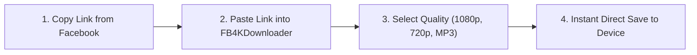

# 🎬 FB4KDownloader — High-Performance Facebook Media Archiving Platform

<div align="center">

[](https://fb4kdownloader.com)
[](https://chromewebstore.google.com/detail/fb4kdownloader-4k-faceboo/cmhlgochpmciomoodleglljgmoclhcif)
[](https://nodejs.org/)
[](https://fb4kdownloader.com)
[](LICENSE)

**An ultra-fast, mobile-first, privacy-compliant web application engineered to parse, extract, upscale, and convert public Facebook videos, Reels, and audio tracks.**

🌐 **Live Website:** [https://fb4kdownloader.com](https://fb4kdownloader.com)

</div>

---

## 📖 Project Overview

**FB4KDownloader** is an independent, full-stack media extraction utility created and engineered by **Shahrukh Ahmad (SRK AMD)**. Built out of a desire to eliminate the spammy redirects, deceptive "virus warning" ads, and broken download links typical of conventional web downloaders, FB4KDownloader provides a clean, honest, and high-performance gateway for users to archive their personal Facebook media.

The system combines a lightweight, ephemeral Node.js streaming crawler with an optimized client-side interface, offering instant downloads in Full HD 1080p, HD 720p, upscaled 4K MP4, and 320kbps MP3 audio.

---

## 🛠️ Languages, Frameworks & Core Tools

FB4KDownloader is engineered with modern web standards, strict privacy guarantees, and zero third-party framework overhead:

| Layer | Technologies & Tools | Purpose & Implementation Details |
| :--- | :--- | :--- |
| **Backend Runtime** | **Node.js (v18+) & Express.js** | Ephemeral event-driven server handling asynchronous HTTP routing, REST API endpoints, and clean extensionless URLs. |
| **Media Extraction** | **Custom Native CDN Crawler** | Direct HTTPS parser interacting with Facebook CDN manifests (DASH & progressive MP4). Uses pooled `Keep-Alive` sockets for near-zero latency. |
| **Media Processing** | **FFmpeg Static Binaries** | Transcodes audio streams into 320kbps MP3 and generates high-resolution video upscaling using custom CRF profiles. |
| **Network & Security**| **Axios, Helmet, CORS, Rate-Limit** | Secure in-memory stream piping (`axiosClient`), rolling memory logs (50 events max), zero persistent disk storage of video files, and protection against abuse. |
| **Frontend UI/UX** | **Vanilla HTML5 & Modern CSS3** | Zero-dependency, lightweight, mobile-first architecture utilizing CSS Custom Properties (Theme v4), responsive grids, and fluid clamp typography. |
| **Client Scripts** | **Modular Vanilla JavaScript (ES6+)**| 1-tap paste auto-fetch, clipboard integration, batch download queue management, and accessible cookie consent persistence. |
| **Browser Extension**| **Google Chrome Manifest V3** | Dedicated Chrome extension for 1-click video detection directly inside Facebook timelines. |
| **Deployment & Ops** | **Hostinger Cloud / Node.js Engine** | Apache reverse proxy with `.htaccess` URL rewriting, HTTPS SSL enforcement, and automated gzip compression. |

---

## ✨ Features & Architecture

### 1. ⚡ Facebook Video Downloader (`index.html`)
- Parses public timelines, watch links, and group video shares.
- Extracts native Progressive MP4 streams (1080p Full HD & 720p HD).
- Transparently labels 4K output as *upscaled resolution* to uphold honest advertising and consumer trust.

### 2. 🎬 Facebook Reels Downloader (`reels.html`)
- Tailored for vertical 9:16 mobile canvas formats.
- Instant responsive video preview prior to downloading.
- Quick-save integration for mobile camera rolls (Android Files & iOS Safari Download Manager).

### 3. 🎵 Facebook to MP3 Converter (`mp3.html`)
- Dedicated audio demuxing engine that strips video tracks and generates clean, high-bitrate (up to 320 kbps) MP3 files.
- Ideal for podcasts, educational lectures, royalty-free audio tracks, and speech archiving.

### 4. 📑 10-Link Bulk Archive Queue (`bulk-fb-reel-downloader.html`)
- Paste up to 10 public links simultaneously.
- Client-side parallel batch queue that fetches media metadata and provides 1-click individual and bulk downloads.
- Capped strictly at 10 items to prevent abusive mass-scraping and comply with platform fair-use rate limits.

### 5. 🛡️ Privacy & Compliance Architecture
- **Zero Permanent Storage:** Media bytes are proxied in volatile RAM buffers directly to the user's browser session and immediately flushed upon stream close.
- **Rolling Memory Logs:** Only the most recent 50 server events are kept in RAM; user IPs, download links, and video titles are never written to permanent disk storage.
- **Creator Notice:** Every downloader form displays a clear statutory notice: *"Only download content you own or have permission to save. Respect creators' rights."*
- **DMCA / Takedown Framework:** Fully compliant DMCA procedure (`/dmca`) with a monitored designated contact (`dmca@fb4kdownloader.com`) and 24–48h SLA.

### 6. 📚 18 In-Depth Publisher Master Guides (`/blog`)
- Fully original, technical encyclopedia covering social media video compression, aspect ratios, Fair Use copyright law, official Facebook DYI backup tools, and troubleshooting.
- Every guide is 1,000–1,300+ words with structured comparison tables, printable checklists, and verified author bylines.

---

## 🚀 How to Run Locally

### 1. Clone the Repository
```bash
git clone https://github.com/srkamd/fb4kdownloader.git
cd fb4kdownloader
```

### 2. Install Dependencies
```bash
npm install
```

### 3. Start the Server
```bash
node server.js
```

### 4. Access the Local Application
Open your browser and navigate to:
```
http://localhost:3000
```

---

## 📖 How to Use FB4KDownloader

### Method A: Web Downloader (Desktop & Mobile)



1. **Copy the Link:** On Facebook (desktop or mobile app), find the public video or Reel. Tap **Share** &rarr; **Copy Link** (or right-click the video timestamp on PC).
2. **Paste the URL:** Visit [fb4kdownloader.com](https://fb4kdownloader.com) and click the **Paste** button.
3. **Select Format:** Click **Download**. Choose your preferred format:
   - **Full HD (1080p)**: Best original balance of quality and file size.
   - **HD (720p)**: Optimized for fast downloading and mobile storage saving.
   - **4K Upscaled**: Enhanced frame dimensions via FFmpeg processing.
   - **Audio MP3**: Extracted 320kbps audio-only file.
4. **Save File:** The file streams immediately to your browser's default download folder.

---

### Method B: Mobile Camera Roll Saving

#### On Android:
1. Open Chrome and visit `https://fb4kdownloader.com`.
2. Paste the link, select resolution, and tap download.
3. The video downloads directly into your device's **Downloads** folder (accessible in *Files* or *Google Photos*).

#### On iPhone / iPad (iOS):
1. Open **Safari** and visit `https://fb4kdownloader.com`.
2. Paste the link and tap your chosen download button.
3. Safari will prompt *"Do you want to download this file?"* — tap **Download**.
4. Tap the Safari Downloads icon in the address bar &rarr; tap the video preview &rarr; tap the **Share** button &rarr; tap **Save Video** to move it directly to your **Photos / Camera Roll**.

---

### Method C: Official Built-in Facebook Backup (No Third-Party Tool Needed)
If you are backing up your **own personal content**, we strongly advocate using Facebook's native tools:
1. Go to **Settings & Privacy** &rarr; **Settings** &rarr; **Accounts Center**.
2. Select **Your Information and Permissions** &rarr; **Download Your Information**.
3. Choose **Specific types of information** &rarr; select **Posts**.
4. Choose your date range, format (HTML/JSON), and select **High** media quality. Meta will email you an official zip archive within 24–48 hours.

---

## 🌐 Live Production Links

| Resource | URL |
| :--- | :--- |
| **Main Web Application** | [https://fb4kdownloader.com](https://fb4kdownloader.com) |
| **Facebook Reels Downloader** | [https://fb4kdownloader.com/reels](https://fb4kdownloader.com/reels) |
| **Facebook to MP3 Audio** | [https://fb4kdownloader.com/mp3](https://fb4kdownloader.com/mp3) |
| **Bulk 10-Reel Archiver** | [https://fb4kdownloader.com/bulk-fb-reel-downloader](https://fb4kdownloader.com/bulk-fb-reel-downloader) |
| **Knowledge Base & Blog** | [https://fb4kdownloader.com/blog](https://fb4kdownloader.com/blog) |
| **About Founder & Architect** | [https://fb4kdownloader.com/about](https://fb4kdownloader.com/about) |
| **Official Chrome Extension** | [Chrome Web Store Listing](https://chromewebstore.google.com/detail/fb4kdownloader-4k-faceboo/cmhlgochpmciomoodleglljgmoclhcif) |

---

## 👤 Author & Lead Architect

**Shahrukh Ahmad (SRK AMD)**  
*Creator & Lead Software Engineer*

- **Website:** [fb4kdownloader.com](https://fb4kdownloader.com)
- **GitHub:** [@srkamd](https://github.com/srkamd)
- **Facebook:** [@srkamdpk](https://www.facebook.com/srkamdpk)
- **Instagram:** [@srkamd](https://www.instagram.com/srkamd/)
- **Technical Support:** [support@fb4kdownloader.com](mailto:support@fb4kdownloader.com)
- **DMCA / Legal:** [dmca@fb4kdownloader.com](mailto:dmca@fb4kdownloader.com)

---

## ⚖️ Legal & Trademark Disclaimer

FB4KDownloader is an independent utility and is not affiliated with, endorsed by, or sponsored by Meta Platforms, Inc. or Facebook. All registered trademarks, service marks, and trade names are the property of their respective owners. 

This tool is strictly intended for personal media backup, lawful educational study, and Fair Use commentary. Users are legally responsible for verifying they hold the copyright or explicit authorization from original owners before downloading or redistributing any third-party digital media.
