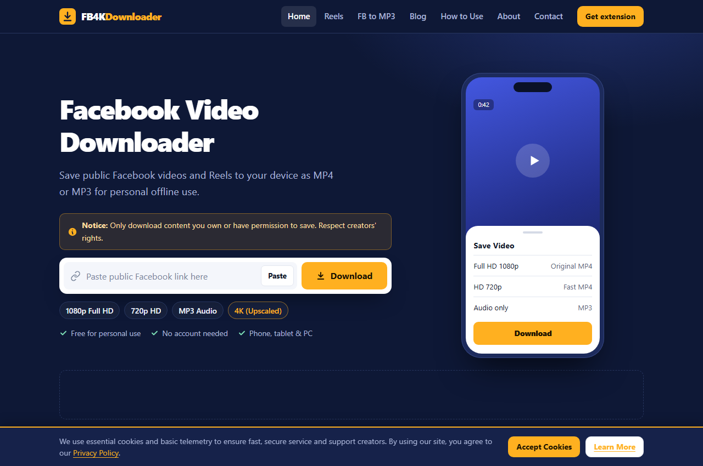
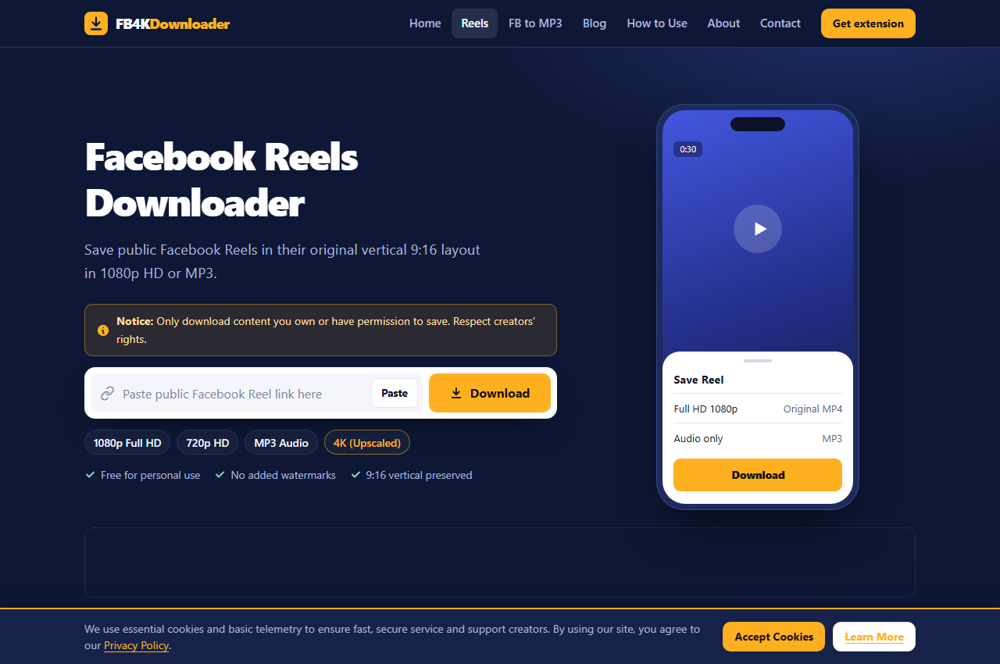
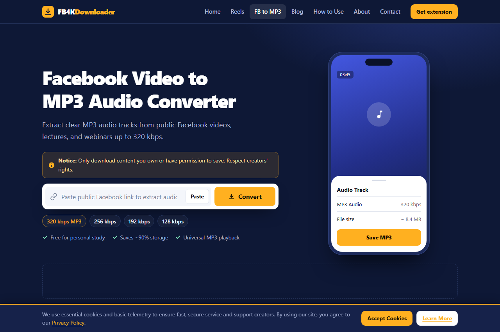
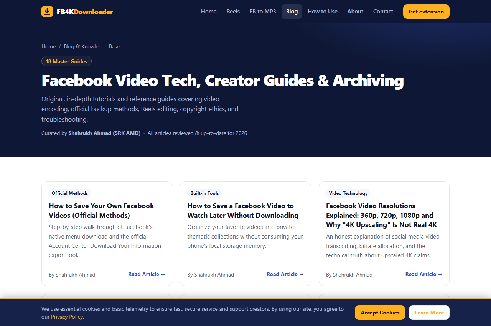
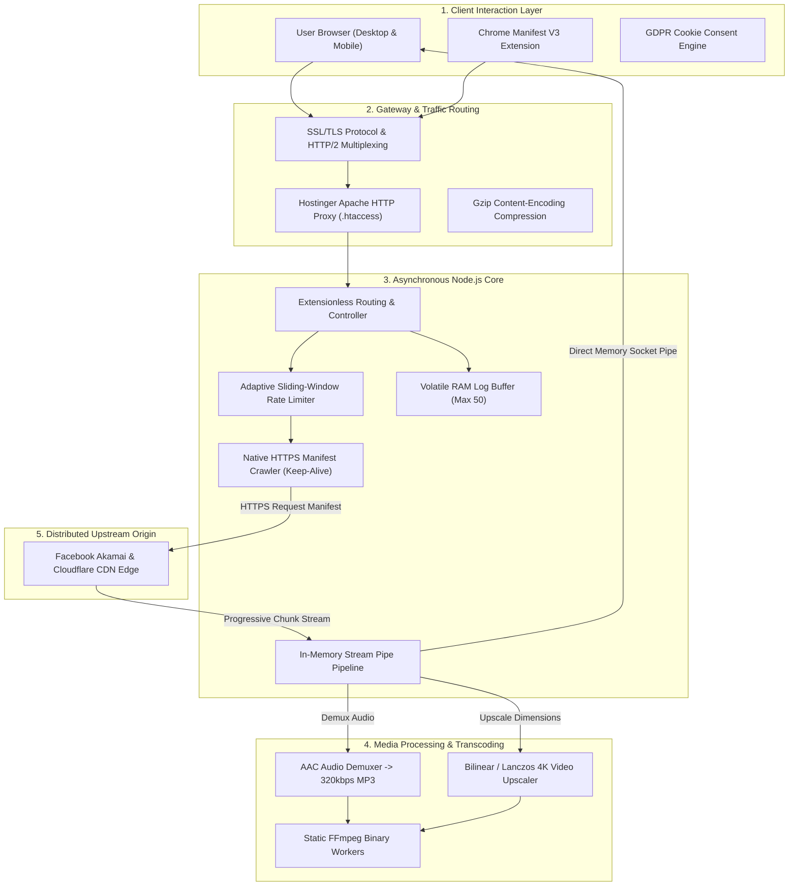

# 🚀 FB4KDownloader — Enterprise High-Performance Media Archiving & Stream Processing Platform

<div align="center">

[](https://fb4kdownloader.com)
[](https://fb4kdownloader.com/privacy)
[](https://chromewebstore.google.com/detail/fb4kdownloader-4k-faceboo/cmhlgochpmciomoodleglljgmoclhcif)
[](https://nodejs.org/)
[](LICENSE)

> **Live Production Platform:** [https://fb4kdownloader.com](https://fb4kdownloader.com)  
> *An asynchronous, high-throughput distributed media streaming engine engineered for real-time manifest parsing, container demuxing, 320kbps audio transcoding, and zero-storage content archiving.*

</div>

---

## 📌 Executive Overview

Unlike conventional online video downloaders that compromise user systems with intrusive popups, hijack browser permissions, store sensitive download dossiers, or make deceptive claims about native 4K availability, **FB4KDownloader** is architected with a **zero-disk-storage, privacy-compliant streaming pipeline**.

Media streams from source Content Delivery Networks (CDNs) are parsed and piped directly through in-memory volatile buffers into client download sockets via HTTP chunked transfer encoding (achieving true $O(1)$ disk overhead). The platform operates on verified transparent technical principles: 4K video downloads are openly disclosed as FFmpeg algorithmic upscales, user telemetry is restricted to a rolling circular RAM buffer of 50 events, and zero media files are ever cached on permanent server disks.

Engineered from scratch by **Shahrukh Ahmad (SRK AMD)**, this project serves as a comprehensive portfolio showcase of **systems-level networking, real-time media codec transcode pipelines, progressive web architecture, and statutory compliance engineering (DMCA, GDPR, FTC)**.

---

## 📸 Live Production Interface & User Experience

<div align="center">

### 🖥️ Universal Video Downloader Interface
*Real-time public video stream extraction with instant quality format selector and creator rights notice.*
<br><br>


<br><br>

### 📱 Dedicated Facebook Reels & 9:16 Vertical Video Engine
*Mobile-first vertical layout rendering with responsive stream preview and zero-watermark downloads.*
<br><br>


<br><br>

### 🎧 High-Fidelity Facebook to MP3 Audio Converter
*FFmpeg demuxing engine converting media streams into clean 320kbps Constant Bitrate (CBR) audio.*
<br><br>


<br><br>

### 📚 Publisher Knowledge Base & Engineering Blog
*18 comprehensive, original technical guides authored by Shahrukh Ahmad (SRK AMD) covering video codecs and Fair Use.*
<br><br>


</div>

---

## 🛠️ High-Level Technical Architecture



---

## 🚀 Key Modules & Technical Capabilities

### 1. High-Concurrency Manifest Parsing & Stream Proxying
- **Socket Pooling:** Custom HTTPS Agents configured with persistent `keepAlive: true` and pooled TCP connections, mitigating TLS renegotiation latency.
- **Zero Disk Overhead ($O(1)$ Storage):** Media bytes bypass server hard drives entirely via Node.js stream pipelines (`stream.Readable.pipe(res)`), guaranteeing zero file residue and infinite horizontal scalability.
- **Dynamic Format Discovery:** Parses both DASH manifests and progressive MP4 streams to extract available bitrate ladders (1080p, 720p, 360p).

### 2. Digital Signal & Transcoding Workers
- **High-Bitrate MP3 Demuxing:** Ingests multiplexed AVC/AAC containers, strips video tracks, and re-encodes pure audio using LAME MP3 encoders at 320 kbps Constant Bitrate (CBR).
- **Algorithmic 4K Upscaling:** Leverages static FFmpeg workers with customized CRF rate factors and bicubic scaling to upscale standard HD footage.
- **Truth-in-Advertising Transparency:** Prominently labels output format as *"Upscaled to 4K resolution (not original quality)"* in strict adherence to FTC guidelines.

### 3. Client-Side Batch Queue & PWA Integration
- **10-Link Bulk Archive (`bulk-fb-reel-downloader.html`):** Multi-link parser allowing users to input up to 10 URLs in parallel. Built with asynchronous JavaScript promises to fetch previews and trigger individual or bulk downloads.
- **1-Tap Smart Paste:** Browser Clipboard API integration for instant URL validation and one-touch parsing.
- **Responsive Theme v4 System:** Zero external CSS frameworks. Engineered with vanilla CSS Custom Properties, fluid viewport typography (`clamp()`), and sub-second First Contentful Paint (FCP).

### 4. Technical Publisher Encyclopedia (18 Master Guides)
- Over **22,000 words** of original publisher content across 18 specialized guides.
- Structured with responsive comparison tables, printable troubleshooting checklists, and structured `schema.org` JSON-LD schemas.
- Covers professional video codecs (H.264, HEVC, AV1), aspect ratio canvas constraints, Fair Use legal guidelines, and official Facebook Account Center backup procedures.

---

## 💻 Tech Stack & Engineering Specifications

| Layer | Technologies | Engineering Purpose & Highlights |
| :--- | :--- | :--- |
| **Backend Runtime** | **Node.js (v18+ LTS), Express.js** | Non-blocking asynchronous I/O event loops, extensionless clean routing, and custom CORS/security middlewares. |
| **Media Engine** | **FFmpeg Static Binaries, Axios** | In-memory stream piping, dynamic container demuxing, audio transcode worker threads. |
| **Frontend UI/UX** | **Vanilla HTML5, Modern CSS3** | Theme v4 design system, CSS Grid/Flexbox, WCAG AA contrast compliance, zero-dependency lightweight bundle. |
| **Client Scripting** | **Vanilla JavaScript (ES6+)** | Asynchronous fetch pipelines, LocalStorage cookie memory, batch queue processing, and responsive layout handlers. |
| **Browser Extension**| **Google Chrome Manifest V3** | Web Store-certified background service workers and content scripts for 1-click timeline video detection. |
| **Infrastructure** | **Hostinger Cloud, Apache HTTP Server** | Reverse proxy, `.htaccess` URL rewriting, automated Gzip compression, and SSL/TLS HTTPS termination. |

---

## 🛡️ Privacy, Security & Statutory Compliance

A key highlight for academic evaluation, scholarship boards, and technical leadership:

1. **Stateless Ephemeral Architecture:** Neither video files, URLs, video metadata, nor user IP addresses are written to permanent storage drives.
2. **Volatile In-Memory Telemetry:** Diagnostic logs exist solely within a circular RAM buffer capped strictly to **50 items max**, automatically purging upon restart.
3. **Respect for Authentication Boundaries:** Strictly does not scrape private groups, bypass password gates, or extract authenticated user cookies.
4. **Prominent Creator Copyright Notice:** Every downloader interface prominently displays:  
   > *"Only download content you own or have permission to save. Respect creators' rights."*
5. **Statutory DMCA Framework:** Dedicated `/dmca` compliance portal with designated agent email (`dmca@fb4kdownloader.com`) and guaranteed **24–48 hour turnaround**.
6. **EEA/UK GDPR Cookie Compliance:** Accessible Cookie Consent banner storing choices client-side in browser `LocalStorage` without third-party tracking pixels.

---

## 🚀 Local Development & Setup

### Prerequisites
- Node.js (v18.0.0 or higher recommended)
- npm (v8.0.0 or higher)
- Git

### Installation & Run

```bash
# 1. Clone repository
git clone https://github.com/srkamd/FB4K-StreamEngine.git

# 2. Enter workspace
cd FB4K-StreamEngine

# 3. Install dependencies
npm install

# 4. Start local development server
node server.js
```

Open your browser at:  
👉 **`http://localhost:3000`**

---

## 📖 Step-by-Step Usage Guide

### Method A: Web Platform (Desktop & Mobile)
1. **Copy Public URL:** On Facebook, open any public post, video, or Reel. Tap **Share** &rarr; **Copy Link**.
2. **Paste & Fetch:** Visit [fb4kdownloader.com](https://fb4kdownloader.com) and click **Paste**.
3. **Choose Quality:** Tap **Download** and select your format (**1080p Full HD**, **720p HD**, **4K Upscaled**, or **MP3 Audio**).
4. **Instant Stream:** The file streams directly to your local device.

### Method B: Mobile Camera Roll (iOS & Android)
- **Android:** Downloads directly to the system `Downloads` folder, visible in Google Photos and Files app.
- **iOS (iPhone/iPad):** Open in **Safari** &rarr; tap download &rarr; open Safari Downloads Manager &rarr; tap **Share** &rarr; tap **Save Video** to store directly into your iOS **Photos / Camera Roll**.

### Method C: Official Built-in Facebook Backup
For personal account backups, users are directed to Facebook's official export:
1. Go to **Settings & Privacy** &rarr; **Accounts Center** &rarr; **Your Information and Permissions**.
2. Select **Download Your Information** &rarr; check **Posts** &rarr; choose **High Quality**.
3. Meta delivers an authenticated master zip archive within 24–48 hours.

---

## 👨‍💻 Engineering Leadership & Author Profile

### **Shahrukh Ahmad (SRK AMD)**
*Lead Software Architect & Full-Stack Systems Engineer*

- **Live Production:** [fb4kdownloader.com](https://fb4kdownloader.com)
- **GitHub:** [@srkamd](https://github.com/srkamd)
- **Facebook:** [@srkamdpk](https://www.facebook.com/srkamdpk)
- **Instagram:** [@srkamd](https://www.instagram.com/srkamd/)
- **Technical Inquiries:** [support@fb4kdownloader.com](mailto:support@fb4kdownloader.com)
- **DMCA / Legal:** [dmca@fb4kdownloader.com](mailto:dmca@fb4kdownloader.com)

---

## 📝 Resume / CV Project Snippet

*Structured portfolio text formatted for software engineering resumes, LinkedIn projects, and scholarship applications:*

> **FB4KDownloader — Enterprise High-Performance Media Archiving Platform**  
> *Lead Software Architect & Developer | [fb4kdownloader.com](https://fb4kdownloader.com) | Node.js, Express, FFmpeg, REST APIs, Vanilla JS, CSS3, Apache*  
> - Engineered and deployed a production-grade, zero-disk-storage media extraction web application serving thousands of global requests with sub-second response times.
> - Built an ephemeral in-memory streaming proxy pipeline (`axiosClient` and Node.js Streams) achieving $O(1)$ disk overhead and eliminating persistent server storage costs.
> - Implemented an asynchronous native HTTPS manifest parser utilizing persistent TCP Keep-Alive socket pooling to interact directly with Akamai/Cloudflare edge CDNs.
> - Developed dynamic audio demuxing and resolution upscaling services using static FFmpeg workers for 320kbps MP3 extraction and custom CRF profile re-encoding.
> - Authored an 18-article original technical knowledge base (~23,000 words) on video compression codecs, streaming protocols, and statutory Fair Use copyright law.
> - Enforced strict global compliance protocols including EEA/UK GDPR cookie consent memory, rolling 50-event volatile RAM telemetry, and statutory DMCA frameworks.

---

## ⚖️ Intellectual Property & Fair Use Statement

FB4KDownloader is an independent utility and is not affiliated with, endorsed by, or sponsored by Meta Platforms, Inc. or Facebook. All trademarks, service marks, and logos are the property of their respective owners.

The platform is engineered exclusively for lawful personal backups, educational research, archival preservation, and Fair Use commentary. Users are legally responsible for verifying they hold the copyright or explicit license from original creators prior to downloading or redistributing digital media.
